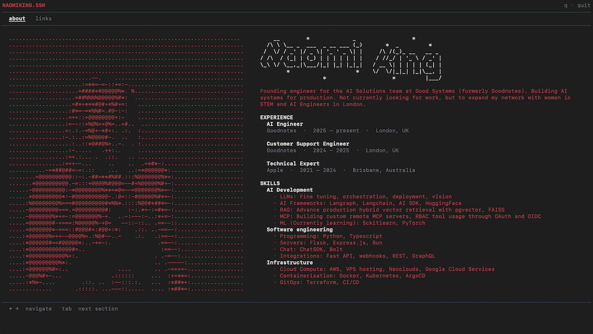

# Terminal Website Portfolio

`ssh naomiking.xyz`

Made a terminal based website as my portfolio. Felt more on brand for an AI Engineer. Written in GO with bubbletea for the TUI framework and lipgloss for the styling.

Run locally

go build
./terminal-website
ssh localhost -p 2222